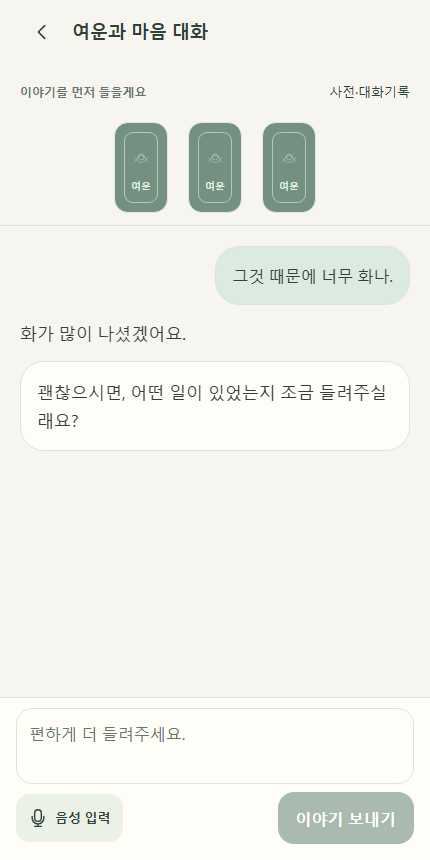
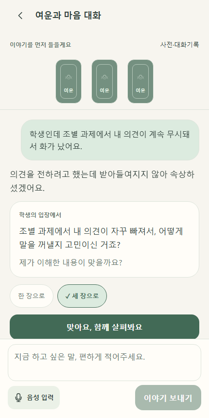
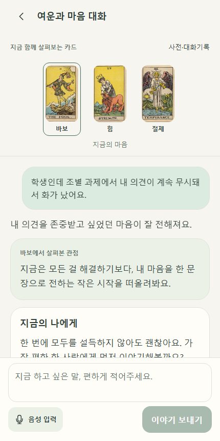
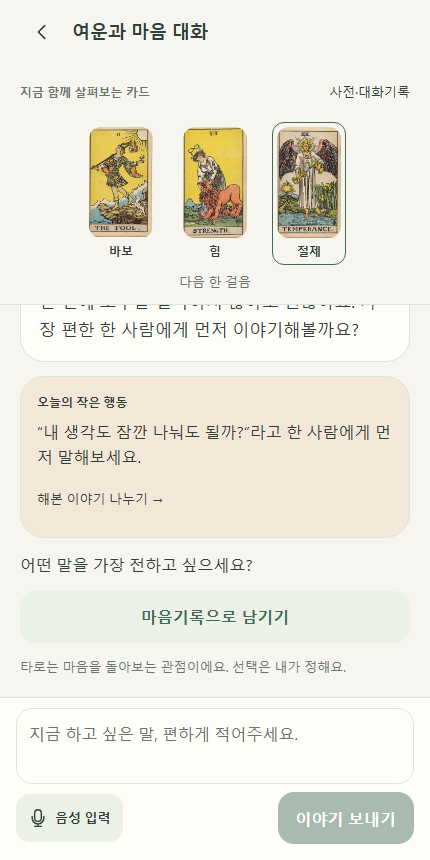

# 여운 타로 상담 · 사용 방법
1. 홈에서 **타로 AI와 이야기하기**를 선택합니다.
2. AI 이용 동의를 확인하고 하고 싶은 이야기를 적거나 음성으로 입력합니다.
3. 짧은 공감과 확인 질문을 읽습니다. 다르게 이해했으면 이야기를 보태고, 맞으면 **맞아요, 함께 살펴봐요**를 누릅니다.
4. 한 장 또는 세 장을 고릅니다. 서버가 뽑은 카드가 위에 남아 있고 아래에서 조언을 읽을 수 있습니다.
5. 카드를 누르면 해당 카드의 관점으로 바뀝니다. 마음에 남은 말은 기록으로 남기거나 해본 이야기를 이어갑니다.
6. **사전·대화기록**에서 용어를 고치거나 지우고 이전 대화를 다시 열 수 있습니다.

일상 고민에는 검색하지 않습니다. 꼭 필요한 상담 표현만 제한적으로 참고합니다.
AI 연결이 준비되지 않았으면 안내를 표시하고 실제 GPT 응답처럼 꾸미지 않습니다.

아래 이미지는 **합성 응답을 주입한 UI 검수용 예시**입니다.

초안은 계정별 메모리에서만 유지합니다. 계정 전환·해제 시 정리되며 앱 프로세스를 닫으면 복구되지 않습니다.
백엔드 보고서와 50개 사례는 taro-back의 docs/counseling/IMPLEMENTATION-20261107.md에 있습니다.
