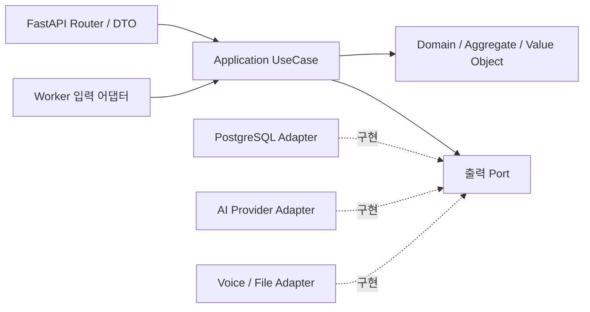

# 여운 아키텍처 큰틀

2026-11-05 · 설계만 작성 · 기존 제품 코드·DB·테스트 변경 없음

## 방향

RN Community CLI와 React 웹은 도메인·API 계약을 공유한다. 백엔드는 FastAPI + PostgreSQL의 모듈형 모놀리스로 시작한다. 한 서버 안에서 타로·대화·기록의 경계를 구분하고, 처음부터 마이크로서비스로 나누지는 않는다.

## React / RN

호출: **Screen → 기능 Hook → UseCase → Repository Port → API Adapter → FetchClient**.

응답: **HTTP JSON → DTO 검증·매핑 → 앱 모델 → Hook 상태 → 화면**.

| 계층 | 책임 | 넣지 않을 것 |
|---|---|---|
| Screen / Component | 표시·입력·내비게이션·접근성 | URL·fetch·응답 JSON 해석 |
| Feature Hook | 로딩·오류·취소·사용자 동작 조정 | 통신 옵션·서버 규칙 원본 |
| Application | 타로 확정·기록 저장·대화 전송 사용 사례 | React UI·fetch 구현 |
| Domain | 모델·값 객체·순수 규칙 | React·HTTP·플랫폼 저장소 |
| Repository Adapter | API DTO와 앱 모델 매핑 | 레이아웃·버튼 상태 |
| FetchClient | HTTP·공통 오류·취소·타임아웃·인증 경계 | 카드·기분·상담 규칙 |
| Config / Catalog | 환경값·콘텐츠·릴리스 버전 | 화면마다 복제한 주소·주제·한도 |

제안 폴더: `app / screens / features / application / domain / data(http,dto,repositories) / config`.

서버 데이터는 조회·캐시 계층, 입력·선택·시트는 화면/기능 상태, 초안·설정은 기기 저장소 포트가 맡는다. 모든 상태를 하나의 전역 Store에 넣지 않는다. 구체 캐시 라이브러리는 아직 확정하지 않는다. [React Hook 분리 참고](https://react.dev/learn/reusing-logic-with-custom-hooks).

## FastAPI 헥사고날 구조

소스 의존성은 안쪽으로 향한다. 출력 어댑터가 포트를 구현하고, composition root에서 구체 구현체를 주입한다. Domain은 FastAPI·Pydantic·SQL·OpenAI SDK를 import하지 않는다. Router는 DTO·인증·사용 사례 호출·응답 매핑만 맡는다. [APIRouter](https://fastapi.tiangolo.com/tutorial/bigger-applications/)와 [의존성 주입](https://fastapi.tiangolo.com/tutorial/dependencies/)은 바깥쪽 어댑터와 조립에 사용한다.

제안 폴더: `bootstrap / interfaces(http) / application(commands,queries,ports) / domain(기능별) / infrastructure(persistence,ai,storage)`.

## DDD 경계

| 경계 | 중심 모델 | 보호할 규칙 |
|---|---|---|
| Tarot | Reading, SelectedSlot | 같은 날 카드 고정·중복 없는3장·확정 후 유지 |
| Conversation | Conversation, Turn, Tone | 확인 후 전송·턴 순서·현재 요청 결과만 반영 |
| Journal | JournalEntry, Mood, Version | 본인 기록·편집 충돌·초안 보존 |
| Catalog | TarotCard, DeckVersion, AssetLicense | 78장 매핑·불변 버전·권리 추적 |
| Identity / Consent | UserId, DeviceSession, ConsentEvent | 소유권·현행 동의·철회 |
| AI 작업 조정 | Job, ProviderRun, UsageReservation | 중복·취소·늦은 응답·한도·결과 검증 |

User가 모든 카드·대화·기록을 품는 거대한 Aggregate가 되지 않게 한다. 경계 간에는 ID로 참조한다. 변경은 Aggregate와 Unit of Work를 통과하고, 조회는 필요한 조회 모델을 사용한다. 단순 CRUD까지 불필요하게 복잡한 객체·이벤트로 포장하지 않는다.

## 하드코딩 방지

- API 주소·타임아웃: 환경 설정·FetchClient 구성.
- 주제·기분·카드·덱: 버전 있는 카탈로그 계약.
- 입력·선택 한도: 서버 규칙 원본과 UI에 전달하는 설정.
- 말투·AI 프롬프트: 서버 정책·프롬프트 버전.
- 사운드·햅틱·모션: 의미 이벤트·디자인 토큰.
- 정적 문구·색상: 문구 리소스·디자인 토큰.

모든 상수를 DB로 옮기는 뜻이 아니다. 비즈니스 데이터·환경값·문구·규칙의 원본을 나누고, 같은 값이 화면마다 복제되지 않게 한다. 프런트 검증은 사용성 보조이며 서버 검증을 대신하지 않는다.

## 요청·트랜잭션 경계

타로: DTO 검증 → 소유권·동의 → UseCase → Reading 규칙 → UoW 저장 → 응답 DTO.

GPT: 짧은 트랜잭션으로 작업 접수 → 외부 API는 DB 트랜잭션 밖에서 호출 → 결과·동의·취소 재검증 → 짧은 완료 트랜잭션. 외부 응답을 기다리며 DB 락을 붙잡지 않는다.

저장: 화면은 SaveJournal 사용 사례만 호출한다. 실제 저장 응답 뒤에 완료 상태와 success 피드백을 전달한다.

지금은 책임·경계·의존 방향·데이터 원본·계약을 결정한다. 구현·패키지 설치·DB 이관·기존 코드 리팩터링은 진행하지 않았다.
