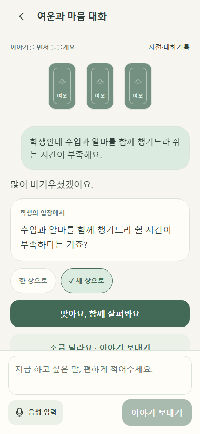
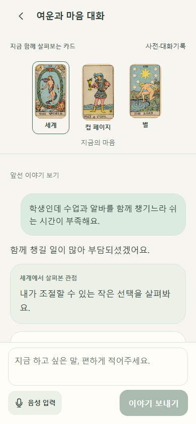

# 상담 TDD 실행 증거

기록의 시각·명령·종료코드와 테스트 SHA256을 evidence/에 보존한다.
원래 구현을 TDD로 소급 표시하지 않는다. 기존 테스트는 백업 Git blob과 대조하여 변경·삭제 0을 확인했다.

- F01-client: API 계약·개인 초안
- F02-conversation: 중복 전송·동일 키 재시도·계정 전환·입력 보존·확인 후 카드 요청
- F03-new-story: 새 이야기 시작 시 이전 비동기 응답 차단

JSON의 tests_sha256/output_sha256는 실행 시 작업 폴더의 원본 바이트다. Windows 줄바꿈이 Git에서 LF로 정규화되는 경우 게시 텍스트 바이트와 다를 수 있다. artifact-manifest.json은 Git index의 게시 바이트 SHA256을 별도로 기록한다.

[결과 보고서](../../counseling/TDD-REBUILD-20261107.md) · [기존 테스트 보존](existing-tests-audit.json) · [빌드 확인](build-verification.json)

## 실제 웹 화면 확인

React 배포 빌드 → FastAPI worker → 격리 PostgreSQL 흐름을 합성 제공자로 실행했다. 실제 GPT 호출과 디자인 검사는 하지 않았다.

[browser-flow.json](browser-flow.json)
