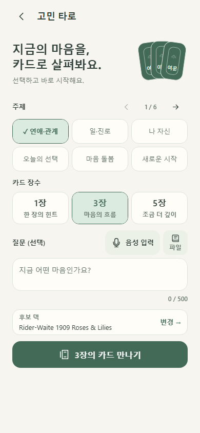
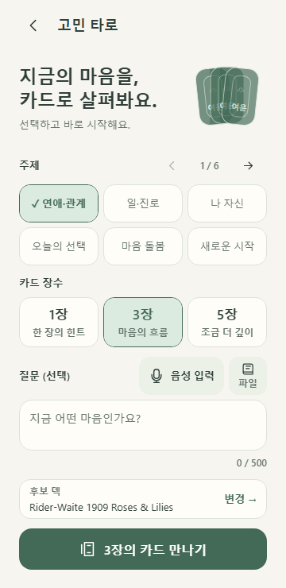

# 최신 타로 설정 화면 · 2026-11-06

확정 범위: **설정을 한 화면에 모으고, 시작을 누르면 카드 선택으로 바로 이동**한다. 카드 선택·결과 화면까지 한 화면으로 합친 기능이 아니다.

| 요소 | 이전 | 현재 |
|---|---|---|
| 주제 | 큰 다이얼과 넓은 칩 배치 | 6개 주제 그룹·작은 이전/다음 대안 |
| 카드 장수 | 세로 공간을 많이 사용 | 1/3/5장 3개 선택·장수에 반응하는 카드 팬 |
| 질문·음성·덱 | 시작 버튼과 함께 화면 아래로 밀림 | 선택 질문·음성/파일·덱·시작을 한 화면에 배치 |
| 시작 | 아래로 내려 찾는 흐름 | 52dp 버튼 한 번 → 직접 카드 선택 |
| 보존 | 기존 초안·덱 계약 | 주제·장수·질문을 덱 왕복 뒤 유지 |

| 모션·접근성 | 실제 설정·동작 |
|---|---|
| 카드 팬 | 320ms 펼침·약3초 idle drift, 1/3/5장 반영 |
| 선택·누름 | 강조180ms, scale0.965/90ms·해제160ms |
| 대안 | 48dp 이상·키보드·reduced motion, 큰 OS 글자에서는 장식 팬 숨김 |
| 수명 | 화면 숨김·이탈 때 반복 중단, 기존 activity lifecycle 사용 |

| 검증 | 결과·해석 |
|---|---|
| RED | 이전390×844에서 덱 bottom1015px로 화면 밖임을 검출 |
| GREEN | 360×740·390×844·430×932, 시작 버튼 y665/h52/bottom717px |
| 의미 있는 회귀 | 신규1 PASS + 기존 관련4 PASS. 선택만으로 리딩 생성0, 시작1회 생성1, 옵션 보존·직접 이동 |
| 기존 전체 회귀 | Back532·RN133·Web130·Browser39·JVM6은 이전 전체 실행값. 이번5개와 합산하거나 전체40 재실행으로 표시하지 않음 |
| 빌드·실행 | RN/Web 타입·Web build·Android release PASS, 실제 에뮬레이터 설정→카드 선택 확인 |
| 원격 CI | RN/Web 기능 커밋 push·PR 검사 성공. docs만 push하는 경우 workflow paths-ignore 적용 |
| 성능 | 최신 JS773.65kB/gzip217.15kB. 최신 설정 FPS는 별도 측정하지 않음. 이전 홈 HWUI·API 순차 표본과 구분 |

소스 기준: RN `33f0ce0dfb29d6dd50bd3a61a8f86b1d7f0d157c`, Web `031709cd29b5e0009bbbb4910a84c417b033c07b`. Backend `dca48868102ee39da6dd2ebf09b7a6405e56dd4a`는 변경하지 않았다.

- [RN PR#4](https://github.com/tarobo22/taro/pull/4) / [Web PR#4](https://github.com/tarobo22/taro-raect/pull/4), base는 기존 비AI 구현 브랜치다.
- [Notion 통합 보고서](https://app.notion.com/p/410b37c6fe7281249a4dfa62b85a3c46?pvs=204)
- 사진·영상은 실제 화면이며 새 합성 게스트만 사용했다. 실제 모델·마이크 호출0, 실제 결제0.
- 화면은 전체 viewport 비율을 보존한다. Android 카드 선택 사진은 실제 스크롤 위치 그대로다.
- 이 문서 갱신에서는 앱 코드·테스트·설정·백엔드를 변경하지 않았다. 최신 UI를 OTA로 다운로드·적용했다고 표시하지 않는다.

실제 OAuth·스토어 상품/과금·iOS native·운영 배포·권리/보관 정책과 새 OTA 다운로드/적용 확인은 계속 별도 출시 작업이다.

## 실제 웹 화면

[Android 사진·6초 영상·통합 PDF](https://github.com/tarobo22/taro/tree/codex/compact-tarot-setup-20261106/docs/reports/non-ai-20261106)

logs/는 표시용 사본으로 줄 끝 공백만 정리했다. 원본 로그 SHA와 동일하다고 주장하지 않는다. browser-evidence.json은 원본 좌표·요청·모션 표본이다.
