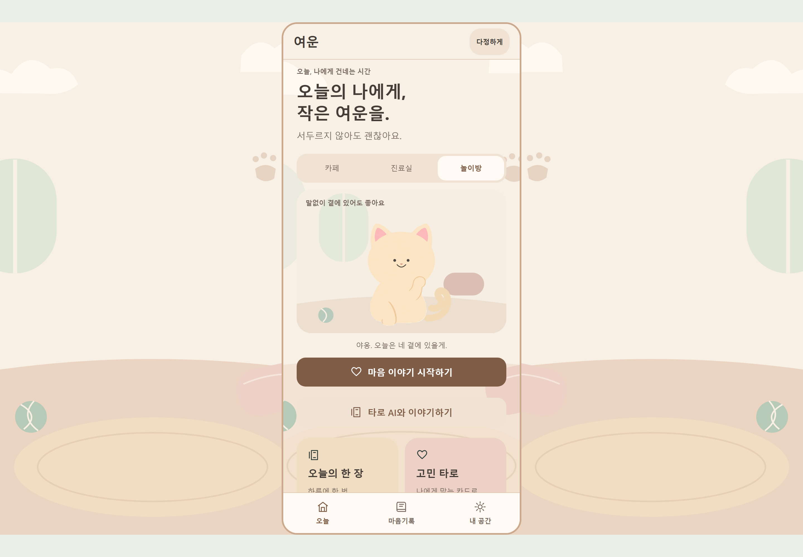

# 여운 - 세 공간·캐릭터 제작 보고
2026-11-07 · 카페 / 마음 진료실 / 고양이 놀이방

## 결과

| 요청 | 반영한 내용 | 화면 |
|---|---|---|
| 단순한 캐릭터 | 셔츠 / 가운 / 크림색 고양이. 장식 없는 실루엣 | [세트 전체](screens/asset-overview.png) |
| 의사 머리 변경 | 이마가 살짝 보이는 단정한 짧은 옆가르마 | [진료실](screens/home-clinic.png) |
| 전체 스킨 | 바깥 방 배경·프레임·상단·하단 탭·버튼·공통 패널을 함께 변경 | [놀이방 전체](screens/desktop-playroom.png) |
| 프로필처럼 분위기 변경 | 공간을 고르면 안내자와 테마가 바뀌고 다음 실행에도 유지 | [동작 기록](browser-capture.json) |
| 자연스러운 손과 팔 | 몸은 이미지, 얼굴과 의사 머리는 SVG | [에셋 명세](../../../assets/skins/README.md) |
| 야옹 | 실제 CC0 녹음을 짧게 가공. 효과음 설정·녹음 차단·1.4초 간격 적용 | [출처](../../../assets/audio/cat_meow.license.json) |
| 소개영상 | 감정적인 도입 → 공간 → 공감·확인 → 카드 → 조언·기록 | [영상](../../../media/three-spaces-20261107/videos) |

## 에셋·디자인 시스템

| 항목 | 수량 / 규칙 |
|---|---|
| 몸 포즈 | 3세트 × 기본·인사·설명 = PNG 9개 |
| 얼굴 | 3세트 × 7표정 × 눈 뜸·깜박임 = SVG 42개 |
| 배경·합성 | 캐릭터 배경 3개, 전체 벽지 3개, SVG 클리핑 9개 |
| 표정 | 편안함·반가움·경청·응원·기쁨·걱정·진지함 |
| 움직임 | 포즈 교체 220ms, 작은 숨쉬기, 150ms 깜박임. 비활성·움직임 줄이기에서 반복 자원 중단 |
| 조작 | 선택 버튼 최소 44dp, 선택 상태 제공, 녹음 중 소리 중단 |

| 공간 | 배경 | 주요 버튼 | 프레임 | 소품 |
|---|---|---|---|---|
| 카페 | #F4F4E9 | #426A56 | #9EB79D | 창, 컵, 나무 바닥 |
| 마음 진료실 | #F0F5F4 | #496C76 | #A3BEC3 | 창, 작은 식물 |
| 놀이방 | #F8EFE5 | #805D47 | #CAA98E | 매트, 쿠션, 공, 발자국 |

PNG는 불투명 원본이며 약한 명암이 남아 있다. 앱에서 SVG 경계로 배경을 가린다. 생성 프롬프트와 원본 해시는 assets/skins에 보관했다. 의사는 가상의 AI 안내 캐릭터다.

## 구현

~~~mermaid
flowchart LR
 UI[홈 / 내 공간] --> State[SkinSelectionStore]
 State --> Storage[기기 외형 설정]
 State --> Provider[SkinProvider]
 Provider --> Theme[themes.json]
 Theme --> Frame[방 배경 / 프레임 / 공통 UI]
 Provider --> Character[SVG 얼굴 + 포즈 PNG]
 UI --> Cue[CharacterCue]
 Cue --> Gate[효과음 설정 / 녹음·백그라운드 차단]
~~~

| 파일 | 역할 |
|---|---|
| src/features/skins/SkinSelection.ts | 저장 포트, 초기 로드, 늦은 응답 방지, 순차 저장·재시도 |
| SkinProvider.tsx / useSkinTheme.ts / catalog.ts | 상태 구독, 플랫폼 저장 연결, 테마 데이터 |
| RoomWallpaper.tsx / SceneArt.tsx / SceneHero.tsx / SkinPicker.tsx | 전체 방 배경·인사·공간 선택 |
| src/components/Character.tsx | 포즈 합성·표정·깜박임·전환 |
| App.tsx / UI.tsx / Home·Settings·Counseling·Talk | 전체 프레임·공통 UI·상담 연결 |
| feedback.web·native.ts / Android·iOS Feedback 모듈 | 기존 소리 차단 경로에 야옹 연결 |

실제 소리 제어 코드:

~~~ts
export class CharacterCue {
 private last = -Infinity;
 request(now: number, enabled: boolean, blocked: boolean) {
  if (!enabled || blocked || !Number.isFinite(now) || now - this.last < 1400)
   return false;
  this.last = now;
  return true;
 }
}
~~~

FastAPI·AI 프롬프트·PostgreSQL 스키마와 상담 계약은 변경하지 않았다. 공간 선택은 기기의 공개 외형 설정으로 저장한다.

## 검증·Git

| 항목 | 결과 |
|---|---|
| 선택 저장 TDD | 양쪽 각각 5건 RED → GREEN: 손상 설정, 늦은 로드, 연속 선택, 저장 실패·재시도, 잘못된 ID |
| 소리 제어 TDD | 양쪽 각각 3건 RED → GREEN: 꺼짐·녹음, 중복 재생, 역행 시계 |
| 전체 기능 회귀 | 웹 158/158, RN 161/161 |
| 타입·패키징 | 양쪽 타입 검사, React production build, RN Android production JS bundle 통과 |
| 웹 실제 동작 | 공간 변경·재실행 복원·상담·이해 확인·카드 결과·기록 입력, 화면 오류 0 |
| Android | Kotlin·리소스 컴파일 통과. 릴리스 APK 조립은 로컬 debug.keystore 누락으로 미완료 |
| iOS | 소스·Sounds 연결. 로컬 Windows에서 Xcode 빌드 미검증 |
| 기존 테스트 | 수정·삭제·완화 없음. 새 파일 2개, 검증 8개만 추가 |
| 디자인 | 실제 화면·영상 샘플 시각 검토. 디자인·스냅샷 테스트 추가 없음 |

저장·재생 제어는 실제 TDD로 진행했다. 디자인은 시각 검토와 타입 검사로 확인했다. 실행 시각·테스트 해시·원본 로그는 [evidence](evidence)에 있다.

| 커밋 단위 | 웹 | RN |
|---|---|---|
| 선택 저장 TDD | 601b2b8 | 6c5dd8f |
| 소리 제어 TDD | c8384e3 | 2e294aa |
| 에셋 세트 | 93616bd | faf3d1d |
| 전체 테마·캐릭터 | c74c7d4 | 428a1ef |

- [웹 브랜치](https://github.com/tarobo22/taro-raect/tree/codex/three-companion-skins-20261107)
- [RN 브랜치](https://github.com/tarobo22/taro/tree/codex/three-companion-skins-20261107)
- [웹 기능 CI](https://github.com/tarobo22/taro-raect/actions/runs/42330099460) / [RN 기능 CI](https://github.com/tarobo22/taro/actions/runs/42330103172)

검증 후 기능별로 push했다. main 병합·운영 배포는 하지 않았다. 테마·표정·이미지의 후속 변경은 기존 JS/에셋 OTA 경로를 사용할 수 있다. 이번 네이티브 야옹 등록은 새 앱 바이너리에 포함해야 한다.

## 영상

| 구간 | 화면·움직임 | 소리 |
|---|---|---|
| 0-7초 | 큰 고양이, 인사·깜박임, 꺼내기 어려운 마음 | 짧은 야옹, 도입 내레이션 |
| 7-18.5초 | 카페 → 진료실 → 놀이방의 전체 테마 | 공간 소개, 선택음 |
| 18.5-29.5초 | 큰 실제 입력·공감·확인 UI, 정확한 클릭 위치 | 전송·확인음 |
| 29.5-40.5초 | 카드 세 장의 순차 3D 뒤집기 | 셔플·뒤집기 |
| 40.5-51초 | 짧은 조언 → 기록 입력, 버튼 강조 | 터치음 |
| 51-60초 | 세 안내자와 “말하지 못했던 마음에, 작은 여운을.” | 엔딩 내레이션·페이드 |

| 납품 | 파일 |
|---|---|
| 60초 가로 소개 | media/three-spaces-20261107/videos/yeoun-three-spaces-landscape-60s.mp4 |
| 60초 세로 소개 | media/three-spaces-20261107/videos/yeoun-three-spaces-portrait-60s.mp4 |
| 30초 사용법 | media/three-spaces-20261107/videos/yeoun-three-spaces-guide-30s.mp4 |
| 편집 원본 | film-template.html, film.html, 내레이션 JSON, 오디오·렌더 도구 |

내레이션은 로컬 Microsoft Heami Desktop 합성음이다. 음악은 직접 만든 88 BPM 피아노이며 야옹은 freemaster2 / CC0다. 실제 React 화면을 크게 재배치했고 상담은 로컬 합성 QA 제공자의 예시다. 이번 제작의 GPT 호출은 0회다. 영상의 60fps는 출력 형식이며 앱 실측 FPS나 AI 품질 상승을 뜻하지 않는다.

## 사용법

1. 홈에서 카페 / 진료실 / 놀이방을 고른다. 전체 분위기와 안내자가 바뀐다.
2. 캐릭터를 눌러 인사한다. 야옹은 내 공간에서 효과음을 켠 뒤 직접 눌러 듣는다.
3. 마음 이야기 시작하기: 좌우 선택·직접 쓰기·음성 입력.
4. 타로 AI와 이야기하기: 동의 → 이야기 → 공감·이해 확인 → 카드·조언 → 마음기록.
5. 내 공간: 말투·효과음·햅틱·배경음·움직임 줄이기 조절.

변경 범위는 요청한 세 캐릭터·방·전체 테마·소리·영상·문서다. 기존 상담 기능과 테스트를 보호했다. 실제 GPT 운영 설정, 서명키 발급, 앱스토어 출시와 운영 OTA 배포는 이번 결과에 포함되지 않는다.

## 제출 자료

- [화면 사진을 넣은 4쪽 PDF](../../../output/pdf/여운_세공간_캐릭터_전체스킨_제작보고서.pdf)
- [실제 변경 파일 전체 목록](CHANGED-FILES.md)
- [원본 이미지·영상·PDF 해시와 검증 기록](DELIVERY-VERIFICATION.json)

최종 영상에서 가로·세로 소개는 각각 60.0초·3,600프레임, 사용법은 30.0초·1,800프레임을 확인했다. 가로 영상 오디오 실측은 -17.4 LUFS, true peak -1.5 dBFS였다. iOS 시뮬레이터 CI는 보고서 작성 시 진행 중이며 [실행 상태](https://github.com/tarobo22/taro/actions/runs/42330103180)에서 확인할 수 있다.
