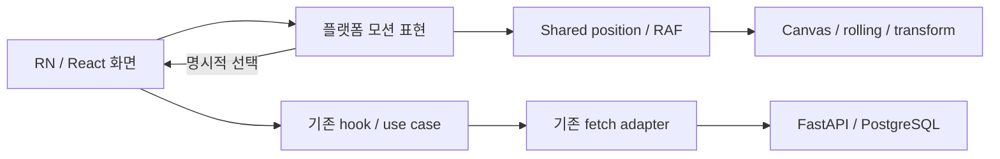

# 여운 디자인·Canvas 모션 개편

다이얼·한 줄 선택·타로 카드 탐색/셔플·대화/스토리 스와이프·감정 확인 시트를 RN CLI와 React 웹에서 수정했다. 파스텔 팔레트와 원본 캐릭터 몸·손·타로 앞면 파일은 유지했다.

## 결과

| 영역 | 반영 |
| --- | --- |
| 다이얼 | 96dp Canvas 눈금 회전·고정 포인터·직접 조작·관성 정착·한 줄 rolling 값 |
| 카드 | 같은 연속 위치로 카드 팬 이동/기울기/크기 연결·명시적 선택·순서 칸에서 취소 |
| 셔플 | 실제 서버 version 성공 갱신 후 210ms 모으기·200ms 교차·330ms 펼치기 |
| 목록 | 감정·주제·말투를 가로 한 줄·고정 라벨 폭·움직이는 선택 배경으로 정리 |
| 대화/스토리 | 손가락 추적·방향 색·약22% 임계값·spring 복귀·퇴장 후 다음 장면 진입 |
| 확인 시트 | 작은 확인 진입·슬라이드·핸들·취소/확정 분리·뒤로가기·dim |
| 캐릭터 | 원본 몸·손 이미지에 실루엣 마스크 적용. 정지 상태에서 머리·손 모두 표시 |
| 감각 | tick·선택·확정·경계 구분, 기존 소리/BGM 기본 OFF·녹음 gate 유지 |
| 접근성 | 48dp 대안·키보드·reduced motion·백그라운드 정리·반복 rolling 라벨 숨김 |

## 실제 동선

설정 → 시작 → 회전으로 초점 이동 → 카드 고르기 → 3장 확정 → 원본 카드 flip·기본 조언 → 마음기록.

주제/말투 → 질문·캐릭터 함께 드래그 → 임계값 미만 spring 복귀 / 선택 시 퇴장 → 선택 반영 → 다음 질문 진입 → 직접 전송.

감정 탐색 → 작은 선택 버튼 → 확인 시트 → 취소 시 기존 mood 유지 / 확정 시 mood만 변경 → 기존 글과 함께 수동 저장.

## 코드 구조



화면은 React 상태와 기존 유스케이스를 사용하고 프레임별 좌표는 플랫폼 표현 컴포넌트가 처리한다. RN은 Reanimated UI thread shared value, 웹은 Canvas2D·RAF·DOM transform을 사용한다. 카드 앞면 결정·서버 저장·대화 전송 계약은 바꾸지 않았다.

```tsx
// ChoiceStage.native.tsx 핵심 구문, 표시용 줄바꿈
const gesture = Gesture.Pan()
  .activeOffsetX([-10, 10]).failOffsetY([-20, 20])
  .onUpdate(e => {
    if (enabled.value) x.value = e.translationX * .92;
  });
// 미선택: withSpring(0).
// 선택: 퇴장 -> onChoice 성공 반영 -> 새 장면 진입.
```

RotarySurface는 카드 팬과 회전 눈금에 같은 p SharedValue를 전달한다. React onChange는 프레임마다 호출하지 않고 눈금 경계에서만 전달한다. 반복 rolling strip은 AT에서 숨기고 현재 선택 값만 노출한다.

## 검증과 한계

이번 요청에 따라 새 디자인 테스트를 추가하지 않았다. 기존 테스트 파일·fixture·mock·snapshot·설정도 수정하지 않았다. 로컬 검증은 RN/Web 타입·웹 production build·Android release 및 실제 핵심 조작/녹화로 진행했다. 전체 테스트 재실행은 로컬에서 하지 않았다. GitHub CI는 기존 동작 테스트·타입·번들/웹 빌드를 그대로 실행한다.

웹에서는 실제 API로 타로 생성·카드 선택·셔플·카드 공개·기본 상담·감정 확인/취소·기록 저장·스토리 결말·움직임 줄이기를 조작했다. runtime error0, API4xx/5xx0이었다. 신규 합성 게스트만 사용했고 실제 GPT·마이크·결제 호출은 없다.

| 웹 구간 | RAF 표본 | 평균 / p95 | >33.4ms |
| --- | ---: | --- | ---: |
| rotary-and-card-fan | 132 | 16.67 / 16.80ms | 0 |
| server-confirmed-shuffle | 67 | 16.67 / 16.70ms | 0 |
| choice-spring-and-next-scene | 140 | 16.67 / 16.70ms | 0 |

Windows·headless Chromium151·390×844의 requestAnimationFrame 콜백 간격이다. GPU 표시 FPS·실기기 touch latency가 아니며 RN HWUI 결과와 직접 우열 비교하지 않는다. 설정 화면은 360×740·390×844·430×932에서 캡처했다.

Android: API35·1080×2400·density420·font1.0, 약30.5초 탐색·셔플·대화·대기 포함. HWUI 1740frames, jank 2.01%, p95 36ms, PSS 331.4MiB. HWUI 통계는 Skia 별도 렌더 루프의 모든 표시 프레임이나 JS FPS·실기기 성능을 대변하지 않는다.

Android 수치는 screenrecord·screencap을 병행한 개발 에뮬레이터 관찰이다. p95 36ms는 16.7ms 예산 내 고정을 증명하지 않는다. 저사양 실기기에서 지연·메모리·물리 햅틱 강도 검증이 남았다. 완벽한 60fps나 출시 품질을 보증하지 않는다.

## 네이티브 앱·코드푸시

RN1.5.0/build6: Skia2.14.0·Reanimated4.5.5·Worklets0.10.4·Gesture Handler2.33.1. 새 네이티브 SDK 때문에 기본 앱 배포가 먼저 필요하다. 이후 같은 네이티브 계약 안의 JS·일반 UI 변경은 기존 OTA 체계를 사용할 수 있다. 이번 새 OTA 서버 기동·다운로드·적용은 실행하지 않았다. QA APK는 에뮬레이터 전용 x86_64·별도 applicationId이며 기존 앱 데이터는 덮어쓰지 않았다. iOS는 코드/버전 반영이며 Mac CI 실행은 대기 상태다.

## Git 단위

| 저장소 | 단위 | 커밋 | 변경 파일 수 |
| --- | --- | --- | ---: |
| taro-raect | runtime | [f36b4d208eda](https://github.com/tarobo22/taro-raect/commit/f36b4d208eda3e99d12847635c71c192208a3a53) | 18 |
| taro-raect | screens | [61efd866fa82](https://github.com/tarobo22/taro-raect/commit/61efd866fa82ac956dc0fb878623f9929e33080e) | 6 |
| taro | runtime | [11965184c3e4](https://github.com/tarobo22/taro/commit/11965184c3e4bfea1156963ff211d08f10694034) | 23 |
| taro | screens | [ecdfd8b7bdb8](https://github.com/tarobo22/taro/commit/ecdfd8b7bdb8d2fdc82049bf97db5ecf2662fdc7) | 5 |
| taro | accessibility | [a27cad0df3ae](https://github.com/tarobo22/taro/commit/a27cad0df3ae7f64c3381eeed806bdb044668a2c) | 1 |
| taro-raect | accessibility | [4bc1cb26efed](https://github.com/tarobo22/taro-raect/commit/4bc1cb26efedf51b306c2e782b038e81f18ff237) | 1 |

각 push 뒤 원격 SHA를 확인했다. RN Mobile CI42219952866·Web CI42219960671 성공. iOS CI42219952776은 대기이며 성공으로 세지 않는다. force push·기존 기록 재작성·main 병합은 하지 않았다.

## 이번에 변경한 제품 파일 전체

### taro (28개)

- App.tsx
- android/app/build.gradle
- android/app/src/main/java/com/yeoun/app/YeounFeedbackModule.kt
- babel.config.js
- index.js
- ios/Yeoun.xcodeproj/project.pbxproj
- ios/Yeoun/Native/YeounFeedback.swift
- package-lock.json
- package.json
- src/components/BottomSheet.tsx
- src/components/CardSlotDial.tsx
- src/components/Character.tsx
- src/components/ChoiceStage.native.tsx
- src/components/ChoiceStage.types.ts
- src/components/MoodDial.tsx
- src/components/MotionRoot.native.tsx
- src/components/OptionRail.tsx
- src/components/RailHighlight.native.tsx
- src/components/RotarySurface.native.tsx
- src/components/RotarySurface.types.ts
- src/components/SelectionDial.tsx
- src/components/StepProgress.tsx
- src/components/TarotSetup.tsx
- src/screens/Journal.tsx
- src/screens/P0Tarot.tsx
- src/screens/Story.tsx
- src/screens/Talk.tsx
- src/services/feedback.native.ts

### taro-raect (23개)

- App.tsx
- package-lock.json
- package.json
- src/components/BottomSheet.tsx
- src/components/CardSlotDial.tsx
- src/components/Character.tsx
- src/components/ChoiceStage.types.ts
- src/components/ChoiceStage.web.tsx
- src/components/MoodDial.tsx
- src/components/MotionRoot.web.tsx
- src/components/OptionRail.tsx
- src/components/RailHighlight.web.tsx
- src/components/RotarySurface.types.ts
- src/components/RotarySurface.web.tsx
- src/components/SelectionDial.tsx
- src/components/StepProgress.tsx
- src/components/TarotSetup.tsx
- src/screens/Journal.tsx
- src/screens/P0Tarot.tsx
- src/screens/Story.tsx
- src/screens/Talk.tsx
- src/services/feedback.web.ts
- src/web/svg.tsx

## 보존·제외

- 기존 App Store 결제 작업과 미커밋 테스트 등 13파일의 SHA256 불변 확인.
- 백엔드·AI·결제 기능·스토어 등록·실제 OAuth·운영 서버는 이번 수정 범위에 넣지 않았다.
- 원본 타로 앞면·캐릭터 몸/손 이미지·이전 보고서는 보존했다.
- 모든 OS·스크린리더 검증 완료를 뜻하지 않는다.

## 자료

- [노션 최신 보고서](https://app.notion.com/p/410b37c6fe7281249a4dfa62b85a3c46?pvs=204)
- [공식 Reanimated 호환표](https://docs.swmansion.com/react-native-reanimated/docs/guides/compatibility/)
- [공식 Skia 애니메이션](https://wcandillon.github.io/react-native-skia/v2/docs/animations/animations/)
- [공식 Gesture Handler](https://docs.swmansion.com/react-native-gesture-handler/docs/fundamentals/getting-started/)

PDF SHA256: f0f549c2ba0325870dbef8abf9813c7d4b234914dd7ead8f9d07fb37c20784a8


## 첨부

- [8쪽 PDF·네이티브 증거](https://github.com/tarobo22/taro/tree/codex/motion-redesign-20261106/docs/reports/motion-20261106)
- [Web 실제 영상](media/motion-walkthrough.webm)
